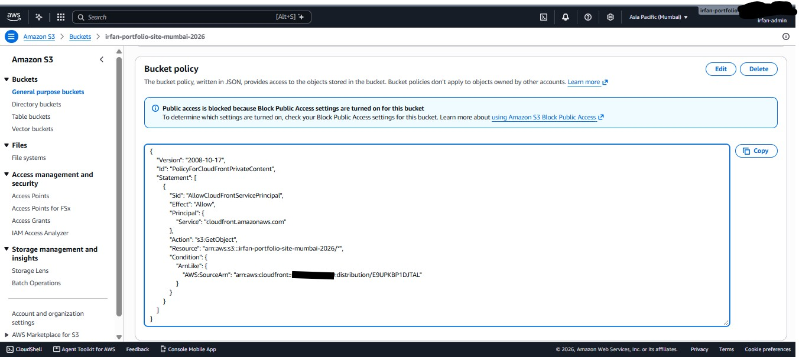
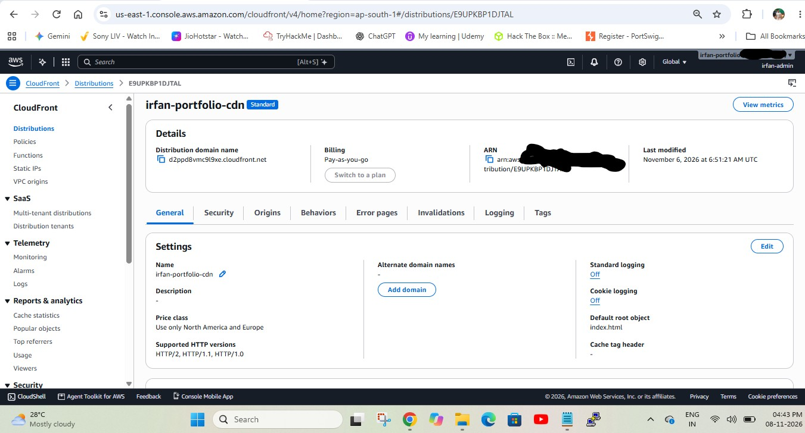
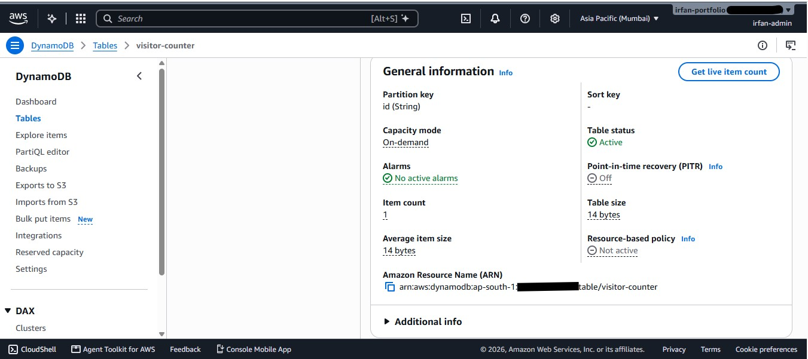
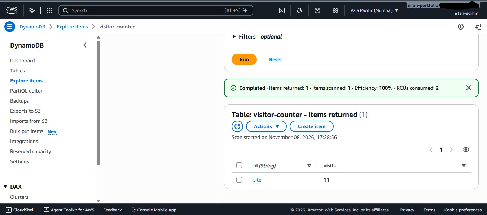
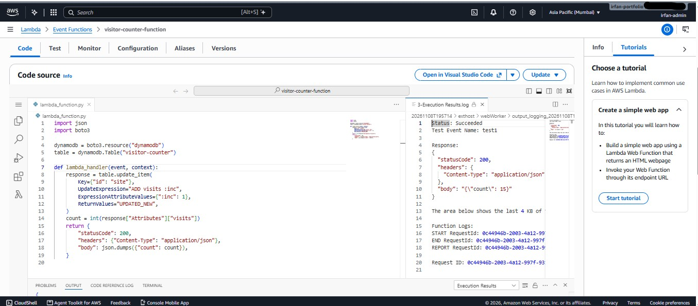
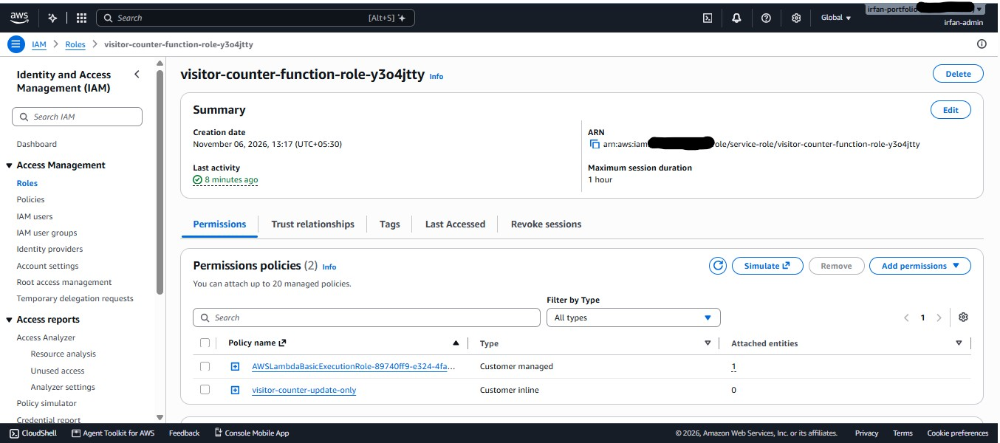
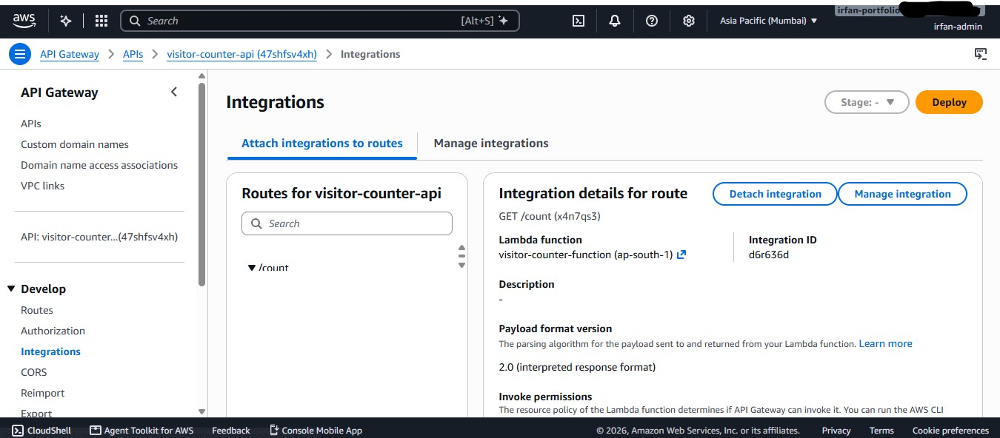
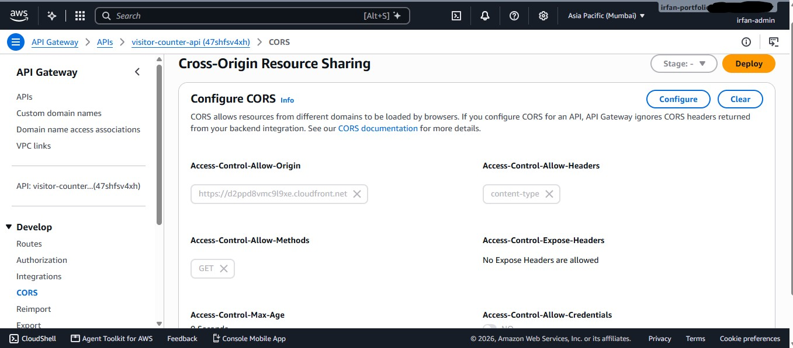

# AWS Cloud Portfolio

A personal portfolio website hosted on AWS, with a serverless visitor counter. I built it to practise core AWS services and security basics, and to document the work the way I would for a team.

**Live site:** https://d2ppd8vmc9l9xe.cloudfront.net


## Architecture

```
Visitor's browser
   |
   |  1. GET page over HTTPS
   v
CloudFront ----(Origin Access Control, signed request)----> S3 bucket (private)
   |
   |  2. Page JavaScript calls GET /count
   v
API Gateway (HTTP API) ---> Lambda (Python) ---> DynamoDB (on-demand)
```

**How a request flows**

1. The browser loads `index.html` from CloudFront. CloudFront fetches it from the private S3 bucket, signing the request with Origin Access Control.
2. The page's JavaScript calls `GET /count` on the API.
3. API Gateway invokes the Lambda function, which adds 1 to a counter item in DynamoDB using an atomic update and returns the new value.
4. The page shows the number in the footer.

## Services used and why

| Service | Purpose |
|---|---|
| S3 | Stores the static site files. The bucket is private. |
| CloudFront | Serves the site over HTTPS. It is the only reader of the bucket. |
| API Gateway (HTTP API) | Public endpoint `GET /count`, with CORS limited to the site domain. |
| Lambda (Python) | Increments and returns the visitor count. |
| DynamoDB (on-demand) | Stores the count. No capacity planning, and negligible cost at this scale. |
| IAM | Least-privilege role for the function, MFA on root and on an admin user. |

## Build walkthrough

### 1. Static hosting: S3 and CloudFront

The site files live in a private S3 bucket in Mumbai (`ap-south-1`).


Block Public Access is on, so nothing in the bucket is public.


The bucket policy lets only the CloudFront service read objects, and only for my distribution (the `AWS:SourceArn` condition).



Requesting the S3 object URL directly returns `AccessDenied`, which confirms the bucket cannot be bypassed.


The CloudFront distribution uses pay-as-you-go billing, the North America and Europe price class, and `index.html` as the default root object.



The distribution has one origin, the private S3 bucket, accessed through an Origin Access Control so CloudFront signs its requests to S3.


The site is served over HTTPS using the CloudFront-provided `*.cloudfront.net` certificate, issued by Amazon.


### 2. Backend: DynamoDB, Lambda, API Gateway

The `visitor-counter` table is in on-demand mode, with a string partition key `id`.



A single item (`id = site`) holds the running count.



The Lambda function (`lambda/lambda_function.py`) increments the counter with an atomic `ADD`, so simultaneous visitors cannot overwrite each other. A test invocation returns `statusCode 200` and the new count.



The execution role has only the standard logging policy plus one inline policy.



The inline policy allows `dynamodb:UpdateItem` on a single table and nothing else (`iam/lambda-dynamodb-policy.json`).


The HTTP API exposes one route, `GET /count`.


The route is integrated with the Lambda function.



CORS allows only my CloudFront domain, only the `GET` method, and only the `content-type` header.



Calling the API directly returns the current count as JSON.


### 3. Account security

MFA is enabled on both the root user and the IAM user used for daily work, and the IAM dashboard shows no open security recommendations.


## Security decisions

- **MFA** on the root user and on the IAM user. The root user is not used for building.
- **Private bucket:** Block Public Access is on, and only my CloudFront distribution can read objects through Origin Access Control.
- **Least-privilege IAM:** the Lambda role can run `dynamodb:UpdateItem` on one table only.
- **CORS** is restricted to the CloudFront domain instead of `*`.
- **HTTPS** is enforced by CloudFront.
- **WAF was considered and not enabled.** The console estimated about $14/month for 10M requests. For a static, low-traffic site with a private bucket, that cost was not justified. I would revisit it if the site gained dynamic features.

### Known limitations

- The API is public by design, since a visitor counter needs no login. CORS only controls what browsers allow, so anyone can call the endpoint directly and inflate the count. Planned mitigation: API throttling and a CloudWatch alarm.
- The counter increments on every page load, including repeat visits and my own. It counts page views, not unique visitors.
- Opening a path that does not exist as a file, such as `/count` on the CloudFront domain, returns `AccessDenied`, because the bucket is private and only `index.html` exists.

## Cost

- AWS Free plan account (credit-based).
- CloudFront on pay-as-you-go ($0/month base) with the North America and Europe price class to limit cost.
- S3, Lambda, API Gateway, and DynamoDB usage is tiny for a portfolio site.
- No custom domain, to avoid the yearly fee.

## Challenges and what I learned

| Problem | Cause | Fix |
|---|---|---|
| Sign-up looped between pages | A Builder ID from the new sign-up flow was created first | Used the advanced sign-up with a different email in an incognito window |
| MFA setup hung | Entered the same code twice | MFA needs two consecutive, different codes |
| S3 bucket created in the wrong region | The console region reset to Stockholm | Deleted it and recreated the bucket in Mumbai (`ap-south-1`) |
| WAF showed an unexpected monthly cost | The wizard enables it by default | Read the price estimate and disabled it |
| Direct S3 URL returned Access Denied | Expected: the bucket is private | Confirmed the site loads only through CloudFront |
| Runtime list for Lambda included a Preview version | Preview runtimes are early releases, not meant for lasting workloads | Chose Python 3.14 from the "Latest supported" list |

## Repository structure

```
site/            Static website (index.html)
lambda/          Lambda function source
iam/             Least-privilege IAM policy for the function
docs/            Notes and screenshots
```

## Notes on the screenshots

- AWS account IDs are hidden.
- Counts shown in the screenshots come from my own testing, and the counter was reset to 0 afterwards.

## Roadmap

- [ ] Deploy the site automatically with GitHub Actions (OIDC, no stored keys)
- [ ] Define the infrastructure in Terraform or AWS SAM
- [ ] Add unit tests for the Lambda function
- [ ] Security headers via a CloudFront response headers policy
- [ ] API throttling and a CloudWatch alarm on Lambda errors
- [ ] Count unique visitors instead of page views

## Author

Irfan - [LinkedIn](https://www.linkedin.com/in/irfan-k-8139a5192)
