# AWS Cloud Portfolio

A personal portfolio website hosted on AWS, with a serverless visitor counter. I built it to practise core AWS services and security basics, and to document the work the way I would for a team.

**Live site:** https://d2ppd8vmc9l9xe.cloudfront.net

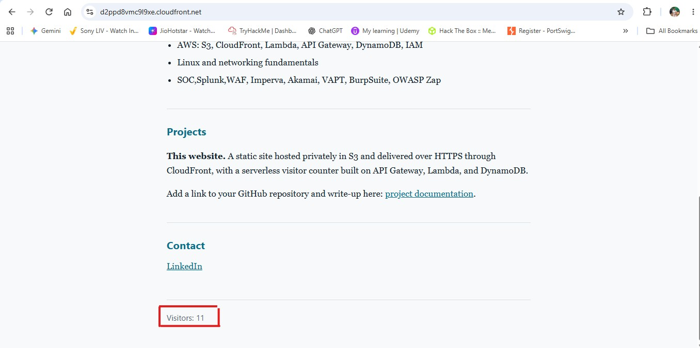

## What this project demonstrates

- Hosting a private static site behind CloudFront with Origin Access Control and HTTPS
- A serverless backend (API Gateway, Lambda, DynamoDB) with an atomic counter
- Least-privilege IAM, MFA, and restricted CORS
- API protection with throttling, and monitoring with CloudWatch alarms and SNS email
- Web security headers (HSTS, a strict CSP without `'unsafe-inline'`, frame and content-type protection), verified with a scanner (A+)
- CI/CD with GitHub Actions: unit tests first, then an S3 upload and a CloudFront cache clear, signing in to AWS with OIDC and no stored access keys
- Cost awareness: pricing the options (such as WAF) before enabling them
- Documentation of decisions, mistakes, and known limitations

## Architecture

```
Visitor's browser
   |
   |  1. GET page over HTTPS
   v
CloudFront ----(Origin Access Control, signed request)----> S3 bucket (private)
   |
   |  2. Page JavaScript calls GET /count
   v
API Gateway (HTTP API) ---> Lambda (Python) ---> DynamoDB (on-demand)

Monitoring:
CloudWatch alarms (Lambda errors, Lambda throttles, API Gateway 5xx) ---> SNS topic ---> email

Deployment:
git push to main ---> GitHub Actions: unit tests ---> OIDC role (short-lived credentials) ---> S3 sync + CloudFront cache clear
```

**How a request flows**

1. The browser loads `index.html` from CloudFront. CloudFront fetches it from the private S3 bucket, signing the request with Origin Access Control.
2. The page's JavaScript calls `GET /count` on the API.
3. API Gateway invokes the Lambda function, which adds 1 to a counter item in DynamoDB using an atomic update and returns the new value.
4. The page shows the number in the footer.

## Services used and why

| Service | Purpose |
|---|---|
| S3 | Stores the static site files. The bucket is private. |
| CloudFront | Serves the site over HTTPS, adds security headers, and is the only reader of the bucket. |
| API Gateway (HTTP API) | Public endpoint `GET /count`, with CORS limited to the site domain. |
| Lambda (Python) | Increments and returns the visitor count. |
| DynamoDB (on-demand) | Stores the count. No capacity planning, and negligible cost at this scale. |
| IAM | Least-privilege roles for the function and for the deploy pipeline, an OIDC identity provider for GitHub, and MFA on root and on an admin user. |
| CloudWatch | Alarms on Lambda errors, Lambda throttles, and API Gateway 5xx responses. |
| SNS | Sends the alarm notifications to my email. |
| GitHub Actions | Runs the unit tests and deploys the site on every push to `main`. |

## Build walkthrough

### 1. Static hosting: S3 and CloudFront

The site files live in a private S3 bucket in Mumbai (`ap-south-1`).

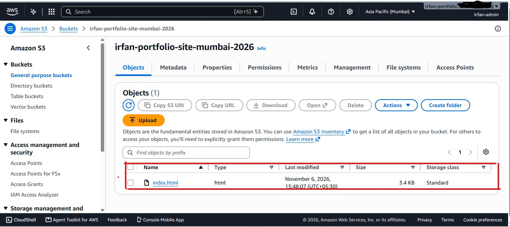

Block Public Access is on, so nothing in the bucket is public.

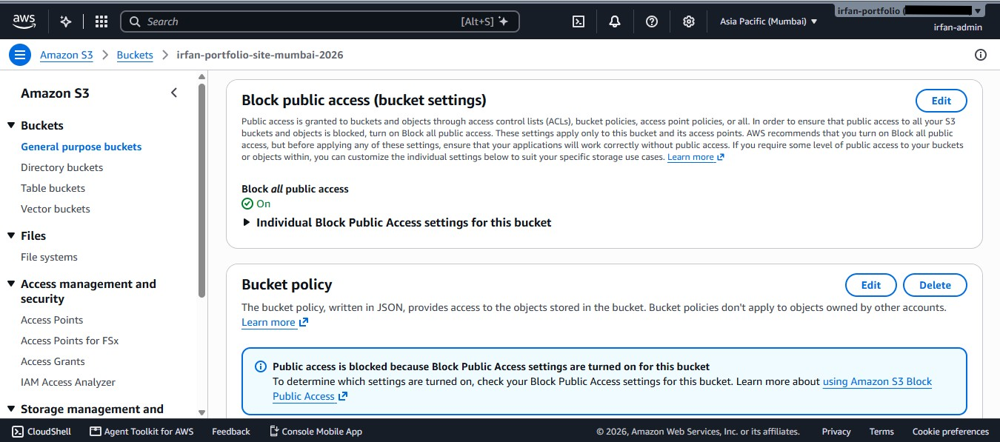

The bucket policy lets only the CloudFront service read objects, and only for my distribution (the `AWS:SourceArn` condition).


Requesting the S3 object URL directly returns `AccessDenied`, which confirms the bucket cannot be bypassed.

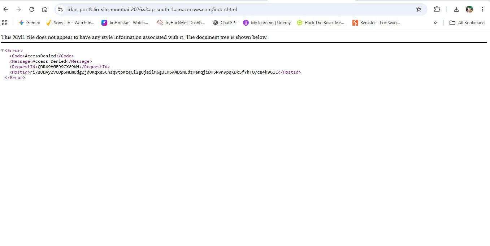

The CloudFront distribution uses pay-as-you-go billing, the North America and Europe price class, and `index.html` as the default root object.


The distribution has one origin, the private S3 bucket, accessed through an Origin Access Control so CloudFront signs its requests to S3.

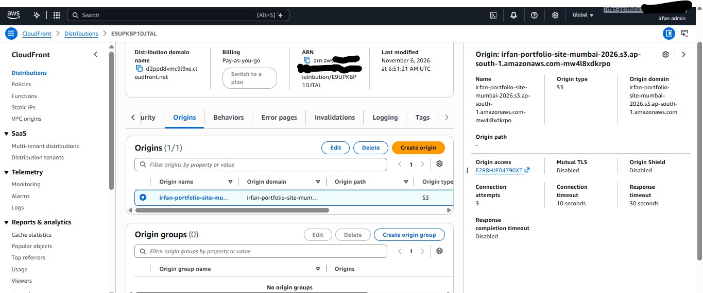

The site is served over HTTPS using the CloudFront-provided `*.cloudfront.net` certificate, issued by Amazon.

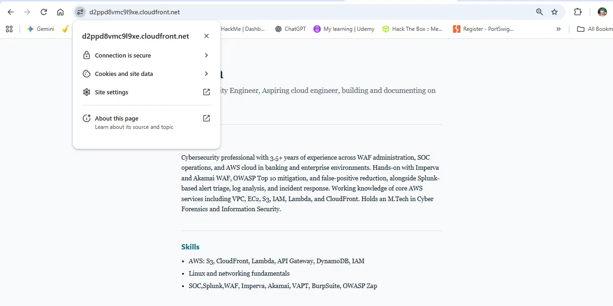

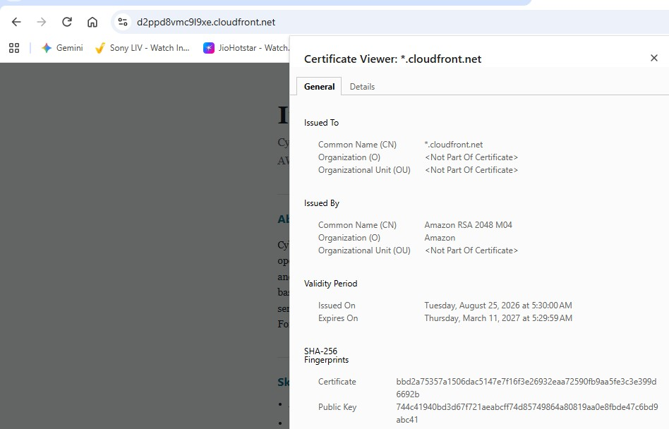

### 2. Backend: DynamoDB, Lambda, API Gateway

The `visitor-counter` table is in on-demand mode, with a string partition key `id`.


A single item (`id = site`) holds the running count.


The Lambda function (`lambda/lambda_function.py`) increments the counter with an atomic `ADD`, so simultaneous visitors cannot overwrite each other. A test invocation returns `statusCode 200` and the new count.


The execution role has only the standard logging policy plus one inline policy.


The inline policy allows `dynamodb:UpdateItem` on a single table and nothing else (`iam/lambda-dynamodb-policy.json`).

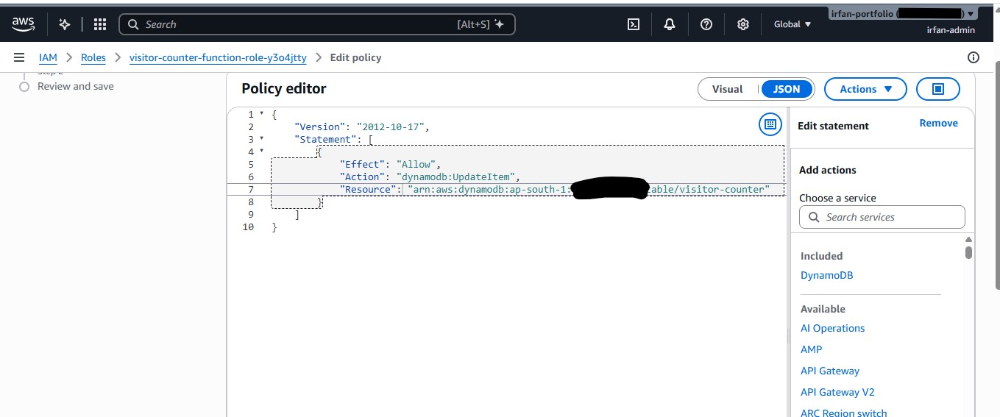

The HTTP API exposes one route, `GET /count`.

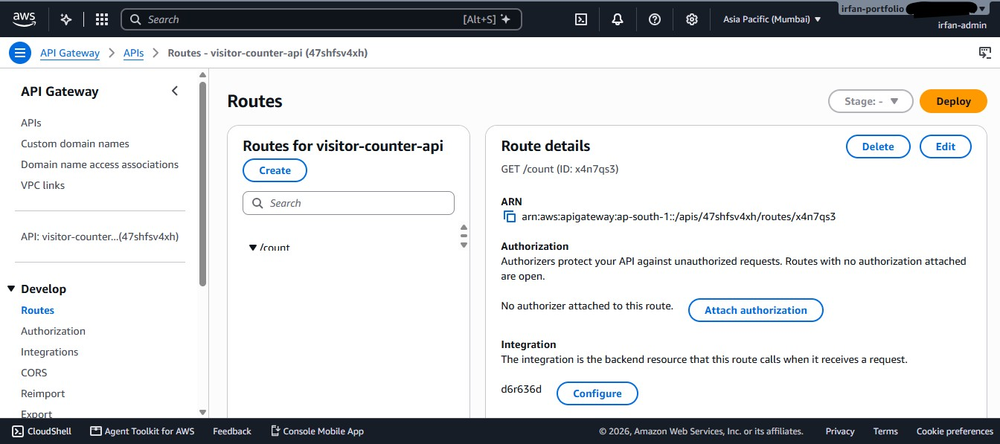

The route is integrated with the Lambda function.


CORS allows only my CloudFront domain, only the `GET` method, and only the `content-type` header.


Calling the API directly returns the current count as JSON.

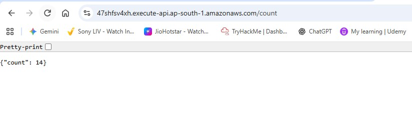

### 3. Account security

MFA is enabled on both the root user and the IAM user used for daily work, and the IAM dashboard shows no open security recommendations.

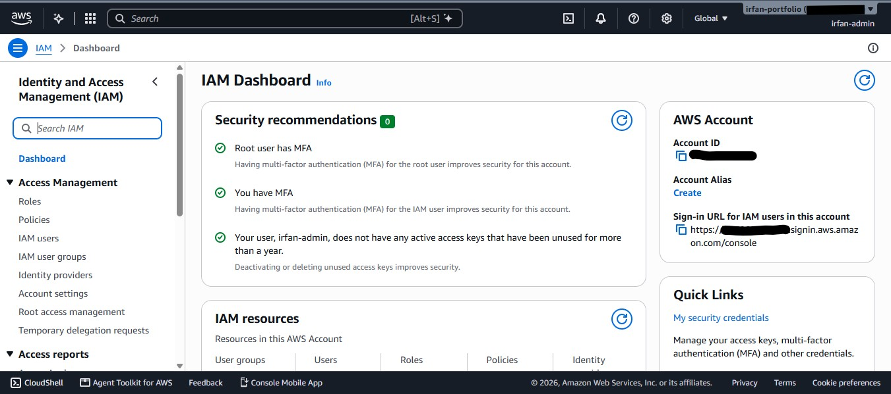

### 4. Protecting the API: throttling

The API is public by design, so I added a default route throttle to the `$default` stage: a rate limit of 5 requests per second and a burst limit of 10. This applies to every route, including `GET /count`.

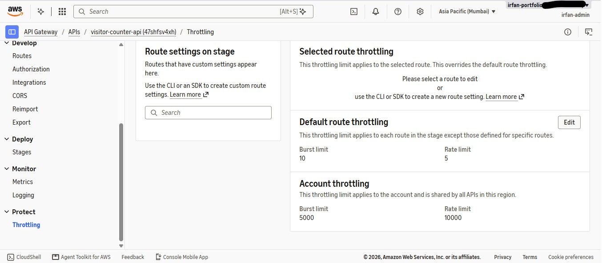

To test it, I sent 60 requests with 20 in parallel from AWS CloudShell, three times. API Gateway rejected the excess requests with `429 Too Many Requests`, while the rest returned `200`.

| Run | 200 | 429 | 503 |
|---|---|---|---|
| 1 | 18 | 16 | 26 |
| 2 | 29 | 18 | 13 |
| 3 | 39 | 21 | 0 |

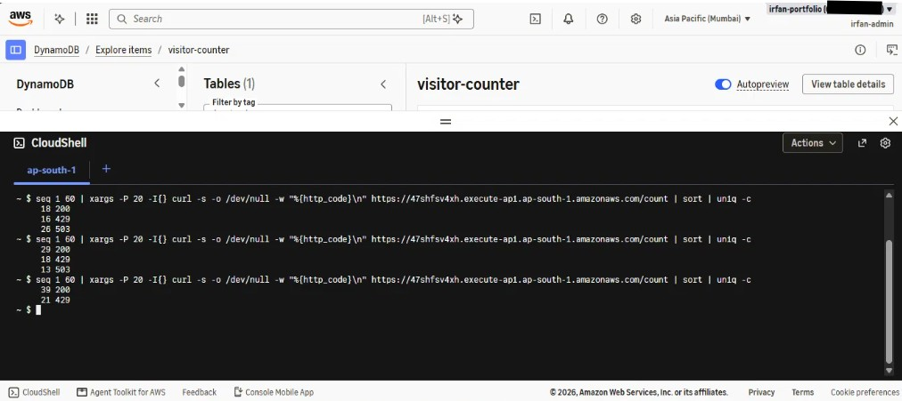

The `503` responses in the first two runs did not come from the API Gateway throttle. The Lambda **Throttles** metric shows spikes of 26 and 13, matching the 26 and 13 `503` responses in runs 1 and 2, and none for run 3. The cause is the default Lambda concurrency limit of 10 on this new account, which rejects bursts of more than 10 simultaneous executions. So the API has two layers of protection, and a single real visitor never triggers either one.

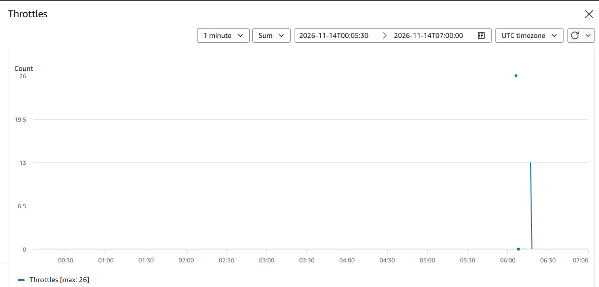

### 5. Monitoring and alerts

Three CloudWatch alarms watch the counter backend. Each one checks a 5-minute window and treats missing data as not breaching, because a quiet site sends no data. All three notify the same SNS topic.

| Alarm | Metric | Condition |
|---|---|---|
| `visitor-counter-lambda-errors` | Lambda `Errors` | Sum of 1 or more |
| `visitor-counter-lambda-throttles` | Lambda `Throttles` | Sum of 5 or more |
| `visitor-counter-api-5xx` | API Gateway `5xx` | Sum of 1 or more |

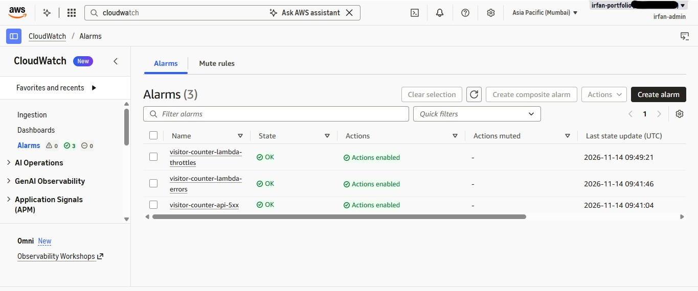

The SNS topic `visitor-counter-alerts` has one confirmed email subscription.

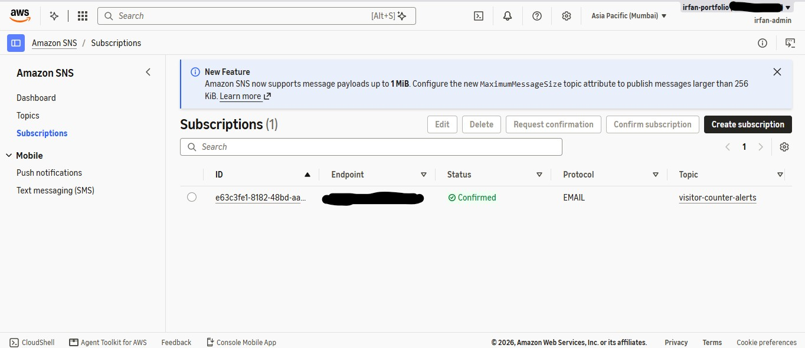

To test the notification path without breaking anything, I published a test message to the topic and forced each alarm into the ALARM state with `aws cloudwatch set-alarm-state`. Each one sent an email.

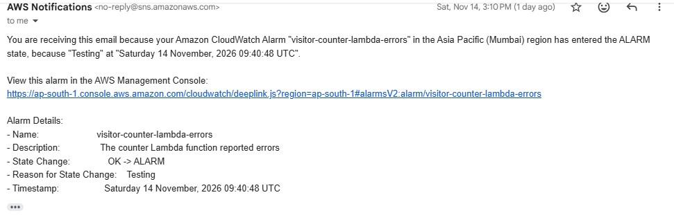

The inbox shows everything received during testing: the subscription confirmation, a manual test message, and one ALARM email for each alarm.


These alarms are health and availability signals. A normal visit triggers none of them. They fire when the counter fails, when a burst of calls hits the Lambda concurrency limit, or when the API returns server errors. They are not intrusion detection, and they would not tell me if someone had broken into the account.

### 6. Security headers

A custom CloudFront response headers policy, `portfolio-security-headers`, is attached to the default cache behavior.

| Header | Value | Protects against |
|---|---|---|
| Strict-Transport-Security | `max-age=31536000` | Downgrade to plain HTTP |
| X-Content-Type-Options | `nosniff` | MIME type sniffing |
| X-Frame-Options | `DENY` | Clickjacking |
| Referrer-Policy | `strict-origin-when-cross-origin` | Leaking URL details to other sites |
| Content-Security-Policy | see below | Injected or third-party content |
| Permissions-Policy | `geolocation=(), camera=(), microphone=()` | Unused browser features |

The Content-Security-Policy allows only what the page needs: its own files and one connection to the API address. The inline CSS and JavaScript were moved out of `index.html` into `style.css` and `script.js`, so the policy needs no `'unsafe-inline'`.

```
default-src 'none'; script-src 'self'; style-src 'self'; img-src 'self' data:; connect-src https://47shfsv4xh.execute-api.ap-south-1.amazonaws.com; base-uri 'none'; form-action 'none'; frame-ancestors 'none'
```

Response headers before the policy:

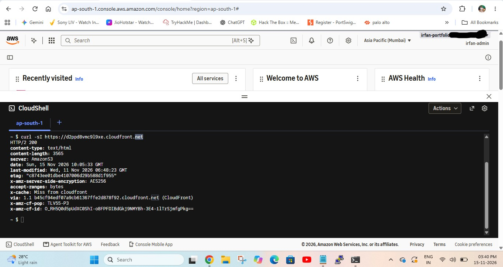

Response headers after:

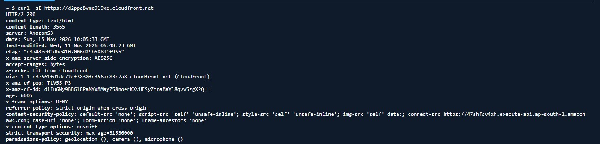

My first scan with securityheaders.com gave grade A with all six headers detected, capped at A because the first version of the policy needed `'unsafe-inline'` for the page's inline script and styles.

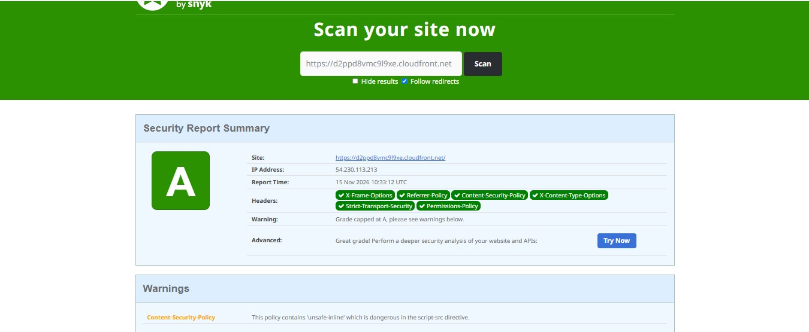

I then moved the inline code into separate files and removed `'unsafe-inline'` from the policy. Requesting the site directly from CloudShell confirms CloudFront is serving the tightened policy:

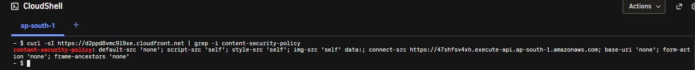

The same scan now gives **A+**.

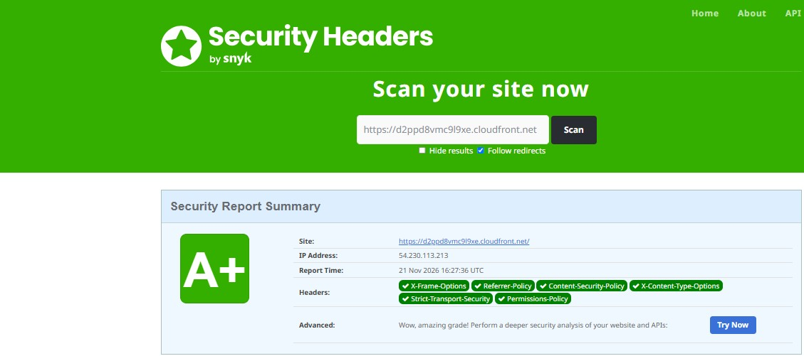

### 7. Automated deployment with GitHub Actions

Every push to `main` runs the workflow in `.github/workflows/deploy.yml`. Changes to `README.md` and `docs/` are ignored, and the workflow can also be started by hand.

1. **Run unit tests.** Four tests in `lambda/test_lambda_function.py` check the counter function. boto3 is patched, so the tests need no AWS account or network. They check that the function returns `200` and the new count, that it uses one atomic `ADD` on the `site` item of the `visitor-counter` table, and that a database error is not swallowed, so the Lambda `Errors` alarm would still fire.
2. **Deploy**, only if the tests pass. The job gets short-lived AWS credentials, runs `aws s3 sync site/ ... --delete`, and then clears the CloudFront cache with an invalidation for `/*`.

**No AWS keys are stored in GitHub.** The job asks GitHub for an OIDC token, and AWS exchanges it for temporary credentials for one IAM role.

- GitHub is registered in IAM as an OpenID Connect identity provider, with `sts.amazonaws.com` as the audience.

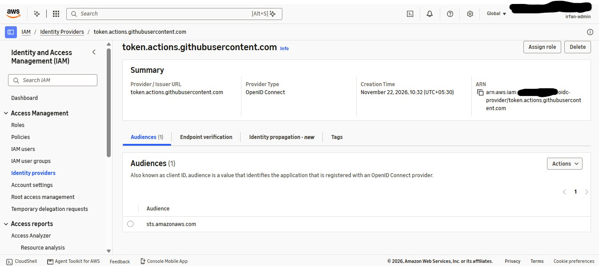

- The role's trust policy accepts only tokens for this repository and the `main` branch. Other repositories, other branches, and other audiences are refused.

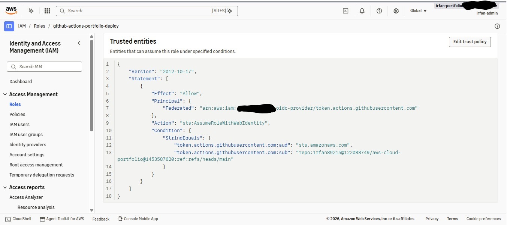

- The role's permissions allow only what the deploy needs: `s3:PutObject` and `s3:DeleteObject` on the bucket's objects, `s3:ListBucket` on the bucket, and `cloudfront:CreateInvalidation` on this one distribution. It cannot touch Lambda, DynamoDB, or IAM. Policy templates are in `iam/`, with the account ID replaced by a placeholder.
- The role's ARN contains the account ID, so it is stored as a GitHub Actions secret (`AWS_ROLE_ARN`) instead of in the workflow file. It is an address, not a credential.

The run history shows a failed first attempt followed by green runs. The failure and its fix are described below.

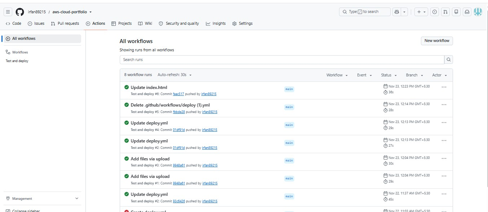

The deploy job uploads the site files and then clears the cache.

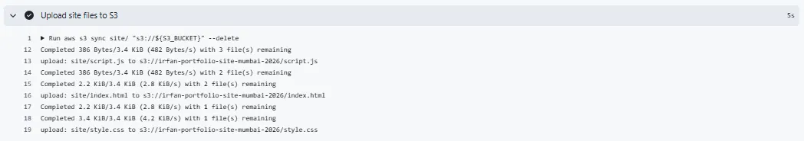

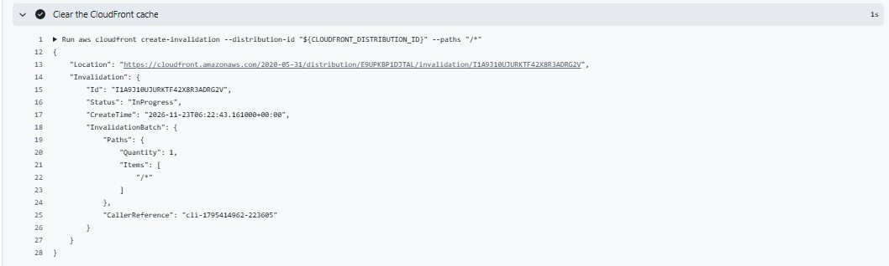

To test the pipeline end to end, I edited a sentence in `site/index.html` on GitHub. The workflow ran by itself, and the change was live on the site a minute later without opening the S3 or CloudFront consoles.

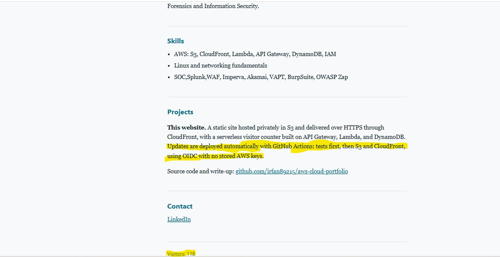

**Troubleshooting the sign-in.** The first run failed at the AWS sign-in step with `Not authorized to perform sts:AssumeRoleWithWebIdentity`, and every retry failed the same way. The trust policy looked correct, and entering the role ARN secret again did not help. I added a temporary workflow step that printed the claims in the OIDC token (not the token itself). It showed that the `sub` claim for this repository includes numeric owner and repository IDs, in the form `repo:<owner>@<owner-id>/<repo>@<repo-id>:ref:refs/heads/main`, while my trust policy expected the plain form. I updated the condition to match, the next run succeeded, and I removed the debug step.

## Security decisions

- **MFA** on the root user and on the IAM user. The root user is not used for building.
- **Private bucket:** Block Public Access is on, and only my CloudFront distribution can read objects through Origin Access Control.
- **Least-privilege IAM:** the Lambda role can run `dynamodb:UpdateItem` on one table only.
- **CORS** is restricted to the CloudFront domain instead of `*`.
- **HTTPS** is enforced by CloudFront.
- **API throttling:** the stage allows 5 requests per second with a burst of 10, so direct calls cannot flood Lambda and DynamoDB.
- **Security headers:** HSTS, `nosniff`, frame protection, a referrer policy, a strict Content-Security-Policy, and a Permissions-Policy are added by CloudFront (grade A+ on securityheaders.com).
- **Alerting:** CloudWatch alarms email me about Lambda errors, throttling, and API server errors.
- **Keyless deployment:** GitHub Actions signs in with OIDC and short-lived credentials, so there are no AWS access keys in GitHub. The deploy role trusts only this repository's `main` branch and can only upload to the site bucket and clear the cache for this one distribution.
- **WAF was considered and not enabled.** The console estimated about $14/month for 10M requests. For a static, low-traffic site with a private bucket, that cost was not justified. I would revisit it if the site gained dynamic features.

### Known limitations

- The API is public by design, since a visitor counter needs no login. CORS only controls what browsers allow, so anyone can still call the endpoint directly and inflate the count. Throttling (5 requests per second, burst 10) limits the speed and the impact, but it does not stop a slow, steady caller. Best-effort limits are targets, not guarantees. CloudWatch alarms tell me about errors and throttling, but they do not block anything.
- The pipeline deploys only the site files. The Lambda function, API Gateway, CloudFront, and the alarms were configured in the console, so they are not reproducible from the repository yet. Infrastructure as code is on the roadmap.
- `aws s3 sync --delete` removes anything in the bucket that is not in `site/`. The sync also re-uploads every file on each run, because a fresh checkout changes file timestamps. That is harmless at this size.
- The workflow actions are pinned to major version tags, not to full commit hashes. Anyone who can push to `main` can deploy, which at the moment is only me. The unit tests use a mocked DynamoDB, so they do not test against real AWS.
- The browser's automatic request for `favicon.ico` returns 403, because the bucket is private and no icon exists. It is harmless.
- The alarms cover availability and abuse of the counter. They would not detect a compromised account or someone reading the static pages. That would need CloudTrail, log analysis, or a threat detection service.
- The counter increments on every page load, including repeat visits and my own. It counts page views, not unique visitors.
- Opening a path that does not exist as a file, such as `/count` on the CloudFront domain, returns `AccessDenied`, because the bucket is private and only `index.html` exists.

## Cost

- AWS Free plan account (credit-based).
- CloudFront on pay-as-you-go ($0/month base) with the North America and Europe price class to limit cost.
- S3, Lambda, API Gateway, and DynamoDB usage is tiny for a portfolio site.
- The three CloudWatch alarms and the SNS email notifications fit within the free allowances (10 alarm metrics and 1,000 email notifications per month). AWS does not charge extra for CloudFront response headers policies.
- GitHub Actions is free for public repositories on standard runners at the time of writing. The cache clear is one invalidation path per run, which is within the monthly free allowance of AWS at the time of writing.
- No custom domain, to avoid the yearly fee.

## Challenges and what I learned

| Problem | Cause | Fix |
|---|---|---|
| Sign-up looped between pages | A Builder ID from the new sign-up flow was created first | Used the advanced sign-up with a different email in an incognito window |
| MFA setup hung | Entered the same code twice | MFA needs two consecutive, different codes |
| S3 bucket created in the wrong region | The console region reset to Stockholm | Deleted it and recreated the bucket in Mumbai (`ap-south-1`) |
| WAF showed an unexpected monthly cost | The wizard enables it by default | Read the price estimate and disabled it |
| Direct S3 URL returned Access Denied | Expected: the bucket is private | Confirmed the site loads only through CloudFront |
| `503` responses during the burst test | The default Lambda concurrency limit of 10 on a new account | Confirmed with the Lambda `Throttles` metric and documented it as a second layer of protection |
| New alarm showed "Insufficient data" | A quiet site sends no datapoints | Set missing data to be treated as not breaching, and the alarm moved to OK |
| Security scanner flagged the Permissions-Policy header as invalid | A stray word in the header value | Corrected the value and scanned again |
| Page lost its styling after moving the CSS and script into files | `style.css` and `script.js` were not in the same folder as `index.html` | Moved them into the `site` folder next to `index.html` |
| Browser console showed a blocked font and an extra stylesheet | A browser extension injected them, and the CSP blocked them | Tested in a private window, where the messages were gone |
| The first workflow run failed to assume the AWS role, on every retry | The OIDC token's `sub` claim includes numeric owner and repository IDs, and my trust policy expected the plain form | Printed the token's claims in a temporary step, updated the trust policy condition to match, and removed the debug step |
| Each push started two workflow runs for a while | The workflow downloaded as `deploy (1).yml` because a file with that name already existed, so two workflow files were uploaded | Copied the content into `deploy.yml` and deleted the duplicate |
| Runtime list for Lambda included a Preview version | Preview runtimes are early releases, not meant for lasting workloads | Chose Python 3.14 from the "Latest supported" list |

## Repository structure

```
.github/workflows/   GitHub Actions workflow (tests, then deploy)
site/                Static website (index.html, style.css, script.js)
lambda/              Lambda function source and unit tests
iam/                 IAM policy templates (Lambda role, GitHub deploy role)
docs/                Notes and screenshots
```

## Notes on the screenshots

- AWS account IDs are hidden.
- Counts shown in the screenshots come from my own testing, and the counter was reset to 0 afterwards.
- The alarm emails were triggered manually with `set-alarm-state` to verify the notification path, not by real failures.
- Email addresses are hidden as well.

## Roadmap

- [x] Deploy the site automatically with GitHub Actions (OIDC, no stored keys)
- [ ] Define the infrastructure in Terraform or AWS SAM
- [x] Add unit tests for the Lambda function, run by the pipeline
- [x] Security headers via a CloudFront response headers policy
- [x] API throttling on the `$default` stage
- [x] CloudWatch alarms with email notification (errors, throttles, API 5xx)
- [x] Tighten the Content-Security-Policy: inline script and styles moved into files, `'unsafe-inline'` removed (A+)
- [ ] Deploy the Lambda function from the pipeline as well
- [ ] Count unique visitors instead of page views
- [ ] Architecture diagram and a short blog post

## Author

Irfan - [LinkedIn](https://www.linkedin.com/in/irfan-k-8139a5192)
